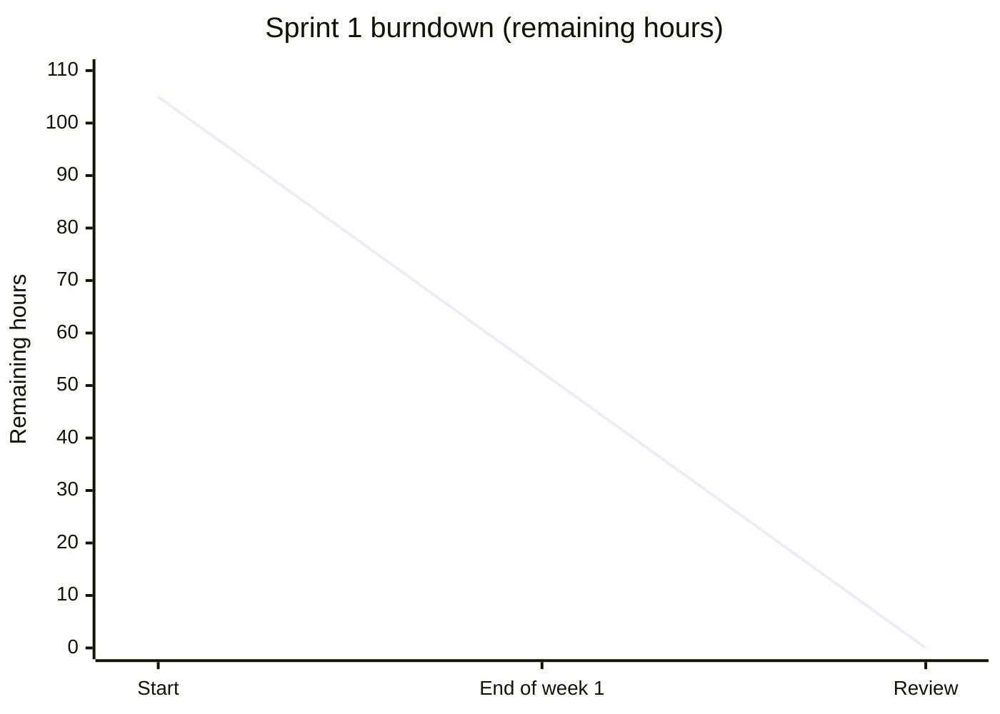

# Sprint 1 backlog · CLARIAH Resource Builder

Project P4 · Software Project · Master HAP/LAP · EHU · 2026-27 · **Team 2**
Kept by: Ángela Garrido (Scrum Master) · Last update: 19 November 2026

> AI use: drafted with the help of an AI assistant (Claude) and reviewed by the team.

**Sprint goal:** one CSV or JSONL file goes end to end from the command line: it is submitted
with its metadata and checksum, its format is checked, every issue is reported, every action is
logged and the results are packaged in a ZIP, with the original file untouched (Epic **E1**).

| | |
|---|---|
| **Sprint** | 1 · GitHub milestone *Sprint 1* |
| **Dates** | <start date> to <date of the review, S06> (2 weeks) |
| **Epic** | E1 · One file end to end (CLI) |
| **Stories** | US-01 to US-07 (issues #16–#22) · 22 points |
| **Supporting tasks** | T-01, T-02 (issues #28, #29) |
| **Capacity** | 5 members × ~15 h = **~75 h** (team charter) |
| **Planned** | **105 h** (first estimate of the tasks in the issues, to be revised at sprint planning) |

> ⚠️ The planned hours are higher than the capacity (risk **R-05** in the
> [risk register](../risks/risks.md)). At sprint planning the team revises the estimates and,
> if needed, the Product Owner moves the last stories to Sprint 2.

## How to use this backlog

- One row per task. Story rows show the points and the sum of the hours of their tasks.
- **Assigned to:** set by the Scrum Master at sprint planning, in consensus with the team
  (team charter §4). The same `@user` is written in the task checklist of the issue.
- **Status:** To do · In progress · In review · Done, the same as the column of the card on the
  [board](https://github.com/users/garazigg/projects/4/views/1).
- **Original estimate:** hours estimated at sprint planning. It does not change during the sprint.
- **Remaining:** hours still needed for the task, updated by its owner at the end of each week
  (0 when the task is done). The *Total* row feeds the burndown chart.
- Real hours are logged as comments in each issue (board guide, rule 3).

## Backlog

| ID | Story / task | Points | Assigned to | Status | Original estimate (h) | Remaining end of week 1 (h) | Remaining at the review (h) |
|---|---|---|---|---|---|---|---|
| **US-01** | **Submit one resource** ([#16](https://github.com/garazigg/Software-Project/issues/16)) | **3** | | | **12** | | |
| | Core `submit` function: detect format by extension and content | | | To do | 4 | | |
| | Metadata record (name, format, size, checksum, date, submitter) saved as JSON | | | To do | 3 | | |
| | Resource id generation and storage folder layout | | | To do | 2 | | |
| | Unit tests with valid and invalid inputs | | | To do | 3 | | |
| **US-02** | **Keep the original untouched** ([#17](https://github.com/garazigg/Software-Project/issues/17)) | **3** | | | **11** | | |
| | Compute SHA-256 at submission, streaming the file | | | To do | 2 | | |
| | Store the original as a read-only copy; every output is a new file | | | To do | 3 | | |
| | Verify the checksum at the start of every later step | | | To do | 3 | | |
| | Test: checksums before and after the pipeline; tampered file | | | To do | 3 | | |
| **US-03** | **Check the format of a resource** ([#18](https://github.com/garazigg/Software-Project/issues/18)) | **5** | | | **21** | | |
| | Agree and document the fixed list of issue types | | | To do | 2 | | |
| | Structure check for CSV and JSONL | | | To do | 5 | | |
| | Column / field name check | | | To do | 3 | | |
| | Missing value check | | | To do | 3 | | |
| | Inconsistent label check (case, whitespace, unknown labels) | | | To do | 4 | | |
| | Test files with one seeded error of each type | | | To do | 4 | | |
| **US-04** | **Format check report** ([#19](https://github.com/garazigg/Software-Project/issues/19)) | **3** | | | **11** | | |
| | Issue data structure (file, row/line, column/field, type, message) | | | To do | 2 | | |
| | Report writer: JSON and a readable text summary | | | To do | 4 | | |
| | "OK, no issues" path and stop rule when there are issues | | | To do | 2 | | |
| | Tests comparing each report with the expected issues | | | To do | 3 | | |
| **US-05** | **Log every action** ([#20](https://github.com/garazigg/Software-Project/issues/20)) | **2** | | | **8** | | |
| | Append-only log (JSON Lines) with the CR-08 fields | | | To do | 3 | | |
| | Call the logger from submit, check and package, including failures | | | To do | 3 | | |
| | Tool version read from the package metadata | | | To do | 2 | | |
| **US-06** | **Package the results in a ZIP** ([#21](https://github.com/garazigg/Software-Project/issues/21)) | **3** | | | **11** | | |
| | Decide and document the folder layout inside the ZIP | | | To do | 2 | | |
| | ZIP builder with report, metadata and log | | | To do | 4 | | |
| | Short README inside the ZIP | | | To do | 2 | | |
| | Test: unzip and check contents and the original's checksum | | | To do | 3 | | |
| **US-07** | **Run every step from the command line** ([#22](https://github.com/garazigg/Software-Project/issues/22)) | **3** | | | **11** | | |
| | CLI as a thin layer over the core module | | | To do | 4 | | |
| | `--help` text for every command and exit codes | | | To do | 2 | | |
| | Installation and usage section in the README | | | To do | 2 | | |
| | End-to-end test of the CLI on the sample files | | | To do | 3 | | |
| **T-01** | **Prepare sample and test data** ([#28](https://github.com/garazigg/Software-Project/issues/28)) | — | | | **11** | | |
| | Script that generates synthetic files and annotation pairs | | | To do | 5 | | |
| | Small CSV/JSONL subsets of the client's datasets, after checking each licence | | | To do | 4 | | |
| | `data/README.md` with source, licence and size; `data/` in `.gitignore` | | | To do | 2 | | |
| **T-02** | **Project set-up: core module, CLI skeleton and tests** ([#29](https://github.com/garazigg/Software-Project/issues/29)) | — | | | **9** | | |
| | Package layout, dependencies and `pyproject.toml` | | | To do | 3 | | |
| | Test framework (pytest) and GitHub Actions | | | To do | 4 | | |
| | Contribution notes: branches, pull requests, issue labels | | | To do | 2 | | |
| | **Total** | **22** | | | **105** | | |

Suggested order: T-02 and T-01 first (everything else depends on them), then US-01, US-02,
US-03, US-04, US-05, US-06 and US-07.

## Burndown chart

Remaining hours of the sprint. The ideal line goes from the planned hours to 0 at the review. At
the end of each week the Scrum Master adds the *Total* of the *Remaining* column to the `Real` line
(uncomment the second `line` and fill in the values; the first line is the ideal one).

If GitHub does not draw the chart, the same numbers are shown in this table:

| Point | Ideal (h) | Real (h) |
|---|---|---|
| Start | 105 | 105 |
| End of week 1 | 52.5 | |
| Review | 0 | |

## Change log

| Date | Change | By |
|---|---|---|
| 19 November 2026 | Sprint 1 backlog created from issues #16–#22, #28 and #29 (first estimate, before sprint planning) | Garazi Garrido |
